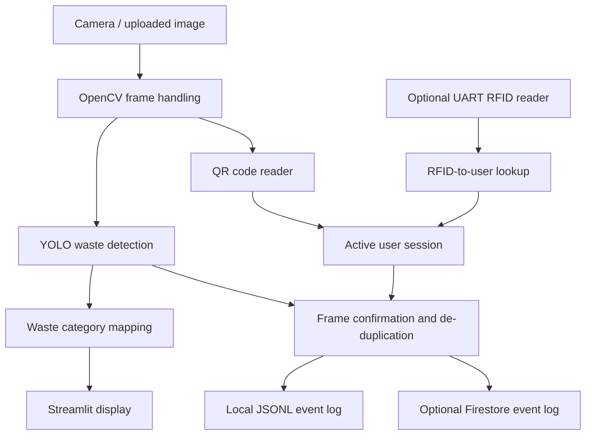

# ♻️ Smart Recycling Bin

**YOLO-powered waste detection, classification and user-linked disposal logging.**

A computer-vision and IoT design project demonstrating how a camera-based waste
recognition system can classify items into **recyclable**, **non-recyclable**, and
**hazardous** groups. The system includes a **Streamlit interface**, optional
**QR-code / RFID identification**, and optional **Firebase Firestore event storage**.

> **Scope:** This is a **waste recognition and record-keeping prototype**, not a
> finished autonomous mechanical sorter. The Python application does not
> control a physical sorter; archived Arduino sketches document separate sensor,
> pump and compressor relay logic. Complete hardware integration and performance
> claims have not been independently verified.

## Original ModuCycle embedded hardware (archived)

ModuCycle began as a **four-member EE3070 university engineering project** with a modular bin hardware design in addition to the camera-based software. This repository now preserves the two surviving **Arduino sketches** from that project, alongside the cleaned-up Python vision prototype. The firmware is provided **as archived**, not as a claim of a fully integrated or production-safe build.

- [Main-bin Arduino firmware](firmware/arduino/Main_Bin_Final/Main_Bin_Final.ino): RFID UID output over serial, ultrasonic fill-level monitoring, fire/gas/temperature inputs and compressor relay logic.
- [Water-bin Arduino firmware](firmware/arduino/WaterBin_ALL_Final/WaterBin_ALL_Final.ino): water sensors, relay-controlled pump and MCP2515 **CAN transmit** status frames (500 kbit/s configured, 8 MHz oscillator, IDs `0x036` and `0x0F6`).
- [Hardware architecture](docs/hardware/README.md) | [CAN message contract](docs/hardware/can-protocol.md) | [Reconstructed Pi CAN receiver + tests](docs/hardware/pi-can-receiver.md) | [Firmware code review and limits](docs/hardware/firmware-notes.md)

**Verification boundary:** The original Pi-side CAN receiving implementation was not recovered. A [new, reconstructed read-only Pi CAN receiver](docs/hardware/pi-can-receiver.md) is now provided as a separate demo, **not** as evidence of historical or end-to-end Pi/Arduino CAN operation. Optional Pi-side serial RFID is a different interface from CAN. The early proposal and hardware drawings describe the **team design**, not necessarily delivered features. Please attribute team work appropriately. Original scanned team documents are omitted from this public repository to avoid publishing other students' identifiers without permission.

## Features

| Component | Implementation |
| --- | --- |
| Computer vision | Custom YOLO `.pt` checkpoint, loaded using Ultralytics |
| Waste taxonomy | **22 item classes**, grouped into 3 waste categories |
| Demo interface | Streamlit UI with uploaded-image inference |
| Live recognition | OpenCV webcam capture on the host / Raspberry Pi |
| User identification | OpenCV QR-code reader; optional Arduino/UART RFID reader |
| Event logic | Consecutive-frame confirmation + duplicate suppression |
| Data logging | Local JSON Lines (`.jsonl`); optional Firestore cloud logging |
| Verification | Unit tests for the event tracker, categories, logging and RFID parser |

## Architecture



**Counting rule:** An item class must be detected in `STABLE_FRAMES` consecutive
frames (default: 5) before one event is counted. It can count again only after
being absent for `RESET_FRAMES` consecutive frames (default: 3). This prevents
repeatedly counting a stationary object on every frame. The tracker is **per
class, not per physical instance**: it does not count two overlapping objects
of the same class separately. For real deployment, use multi-object tracking
and an explicit disposal trigger (e.g., beam-break sensor).

## Quick start (demo mode — no Raspberry Pi or Firebase required)

1. Install Python 3.10+ (Python 3.10 or 3.11 recommended) and create a virtual environment:

   ```bash
   python -m venv .venv
   ```

   On Windows PowerShell:

   ```powershell
   .\.venv\Scripts\Activate.ps1
   ```

   On macOS / Linux:

   ```bash
   source .venv/bin/activate
   ```

2. Install dependencies:

   ```bash
   python -m pip install -r requirements.txt
   ```

3. (Optional) Create a local configuration:

   ```bash
   cp .env.example .env
   ```

   On Windows PowerShell, use `Copy-Item .env.example .env` instead.
   You can also run the project using the included defaults, without `.env`.

4. Launch the dashboard:

   ```bash
   streamlit run app.py
   ```

5. Choose **Upload an image**, select a photo, and click **Analyse image**.
   Upload mode only demonstrates detection and classification; it **does not
   create disposal events**.

The included checkpoint is `weights/best.pt`, supplied with the original design
project. It is approximately 6 MB. **Only load model files you trust**: a PyTorch
checkpoint may include serialized Python objects.

## Live webcam / Raspberry Pi setup

- Connect a webcam to the **machine that runs Streamlit**. Browser-connected
  cameras on remote computers are **not** accessed by `cv2.VideoCapture(0)`.
- In the dashboard select **Live local webcam**, set a user ID (or present a
  QR code), then activate **Start live camera**.
- The default camera source is `0`. To use another local camera device or video
  capture source, change `CAMERA_SOURCE` in `.env`.
- Python packages such as PyTorch / OpenCV may require platform-specific
  installation steps on Raspberry Pi (especially older 32-bit installations).
  CPU inference on a Pi 4B can be slow. **Hardware FPS and model compatibility
  must be tested on your actual device.**

A QR code should contain **only a short user ID**, such as `demo_user`.
Accepted IDs contain 1–128 letters, digits, `_`, `-`, `.`, or `@`.
Avoid encoding personal details or sensitive information in QR codes.

### Optional RFID reader

Install optional components:

```bash
python -m pip install -r requirements-optional.txt
```

For an Arduino/UART RFID setup, set `RFID_PORT` to the actual serial device
(e.g. `/dev/ttyAMA0` on some Raspberry Pi configurations, or `COM3` on Windows)
and confirm `RFID_BAUDRATE`. The serial reader expects newline-terminated lines:

```text
UID: 0123ABCD
```

The port is opened only when live detection needs it. The code **reads RFID IDs**;
the Arduino reader firmware, wiring, and electrical interface are **not**
included here. Enable UART and check permissions, voltages and port mapping
for your specific setup. Without Firebase, the UID itself is treated as the
local prototype user ID.

### Optional Firebase Firestore

1. Create a Firebase project with Firestore enabled.
2. Download the service-account credentials for **your own project** and save
   them locally, for example: `secrets/firebase-service-account.json`.
3. Set `FIREBASE_CREDENTIALS=secrets/firebase-service-account.json` in `.env`.
4. Install `requirements-optional.txt` and restart Streamlit.

Firestore events are appended under:

```text
users/{user_id}/events/{auto_generated_document_id}
    amount: 1
    category: "Recyclable" | "Non-recyclable" | "Hazardous"
    item: "plastic_bottle"   # example
    timestamp: "2026-...+00:00"
    user_id: "demo_user"
```

For an optional RFID-to-username mapping, create a document such as:

```text
userid/0123ABCD
    username: "demo_user"
```

The Firebase Admin SDK runs on the trusted server, **never on a publicly
untrusted client**. Restrict access and use a dedicated service account with
appropriate permissions. All credential files, `.env` and local event logs
are excluded by `.gitignore`. Never commit a private key to GitHub.

Local events are appended to `data/waste_events.jsonl`. If Firestore is not
configured or a cloud write fails, the local log can still operate. This is a
prototype, not a reliable offline synchronization queue; cloud retries,
access controls and production-grade privacy safeguards are future work.

## Repository structure

```text
smart-recycling-bin/
├── app.py                      # Streamlit dashboard
├── smart_bin/
│   ├── config.py               # Class taxonomy and environment settings
│   ├── detection.py            # YOLO inference adapter
│   ├── identity.py             # QR and optional serial RFID input
│   ├── logic.py                # Classification and detection event tracker
│   ├── can_receiver.py         # Reconstructed, read-only SocketCAN receiver
│   └── storage.py              # Local JSONL / optional Firestore adapters
├── firmware/arduino/          # Archived main-bin and water-bin Arduino sketches
├── docs/hardware/            # Hardware, CAN message and firmware notes
├── weights/
│   └── best.pt                 # Supplied YOLO model checkpoint
├── tests/                      # Unit tests (no camera or cloud required)
├── docs/
│   └── refactor-notes.md       # Key changes from the original prototype
├── data/                       # Generated events (git-ignored)
├── .env.example
├── .gitignore
├── requirements.txt
├── requirements-optional.txt
├── requirements-can.txt      # Optional python-can dependency
└── requirements-dev.txt
```

## Run tests

```bash
python -m pip install -r requirements-dev.txt
python -m pytest -q
```

These tests verify the **non-hardware application logic**. The refactor still
needs end-to-end verification with an actual webcam, the supplied YOLO weights,
RFID hardware and a correctly configured Firebase account.

## Waste labels

The 22 exact class names from the supplied model are kept unchanged so YOLO
predictions match the mapping. This includes typos in the original dataset
(`plastic_cultery`, `reuseable_paper`). Some categories (e.g., dirty paper or
plastic packaging) depend on local waste collection rules; this taxonomy is
**a design-project mapping, not authoritative municipal recycling advice**.

## Project background and future work

This repository is a cleaned, portfolio-oriented version of a design project
prototype. It demonstrates integration of computer vision, an interactive user
interface, user identification and optional cloud persistence.

Potential improvements include instance tracking, transaction/retry queues,
real-world accuracy/latency evaluation, a Raspberry Pi benchmark, authenticated
user registration, electronics documentation, and a physical sorting actuator.

**For a stronger project showcase:** add your own photos of the finished bin,
a demo GIF/video, an architecture photo, your individual contributions,
and (if you have them) dataset/training methodology and measured results.

### Model and licensing note

The original checkpoint is included for reproducibility; no dataset, training
script, accuracy report or license evidence was provided with these source
files. Before open-sourcing a model or choosing a repository license, confirm
your ownership / permission for the model, training data and dependencies
(including the applicable Ultralytics licensing terms). No software license
has been asserted on your behalf.

See [`docs/cv-and-portfolio.md`](docs/cv-and-portfolio.md) for a concise
project summary and CV bullet-point options.
